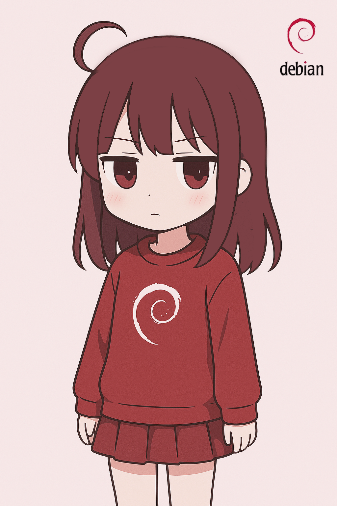

# 𖦹 Debby Maskot Debian Linux 𖦹
 
**Namaku Debby** maskot Debian Linux yang mempunyai ekspresi datar `(Kuudere)`. 

Aku dibuat untuk mendampingi Debian yang selalu inovatif dan adaptif sama perkembangan teknologi.   

Dengan warna merah dan putih yang jadi ciri khas Debian, plus sentuhan desain minimalis, aku siap nemenin kamu di dunia open source yang seru ini.

:::tip[Debby Philosophy]  
 `Deb` : Debian  
 `By` : Minimalist  
 `Debby` : Representasi Debian dengan tampilan yang minimalis
:::

  

Jadi... gimana menurut kalian soal penampilanku?   
Worth it nggak kalo aku jadi maskot alternatif Debian? Share pendapat kalian di komen ya!

:::warning[Debby Said :]   
*Aku nggak peduli kalian suka atau nggak --*
:::  
   
See you next time, Yoroshiku ♡  

---